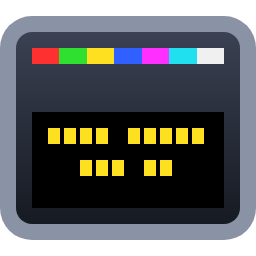

# NewforTest

Tools for testing teletext subtitle inserters that use the **Newfor** protocol over TCP/IP. NewforTest sends test subtitles, your own text, or whole **SRT** and **EBU STL** files to an inserter, timed to the frame, and shows exactly what it sent.

There are two apps, built on the same core:

| App | Use it for |
|-----|-----------|
| **NewforTestGui** | Everyday testing: a live teletext preview, style controls, file playback with a cue list, and a packet log. |
| **NewforTest** | The console (keyboard-driven), plus scripted modes (`--send`, `--play`, `--soak`) for automation and CI. |

Version 4.0. MIT licensed.

---

## Contents

- [Getting started](#getting-started) (including [Linux](#linux))
- [The GUI](#the-gui)
- [The console app](#the-console-app)
- [Scripted use](#scripted-use)
- [Subtitle files](#subtitle-files)
- [Layout: rows, justification and boxes](#layout-rows-justification-and-boxes)
- [Character sets](#character-sets)
- [Receiver behaviour worth knowing](#receiver-behaviour-worth-knowing)
- [Protocol implementation](#protocol-implementation)
- [Building, testing and publishing](#building-testing-and-publishing)
- [Project structure](#project-structure)
- [Version history](#version-history)
- [Licence and acknowledgements](#licence-and-acknowledgements)

---

## Getting started

### Requirements

- **Running:** the released Windows x64 exes are self-contained single files, so no .NET install is needed. On Linux, build from source (see [Linux](#linux)).
- **Building:** the [.NET 10 SDK](https://dotnet.microsoft.com/download).
- **A Newfor inserter** on the network, and the teletext subtitle page it carries (usually **888**).

The GUI uses [Avalonia](https://avaloniaui.net/), so it also builds for Linux and macOS. Windows and Linux have been tested; macOS has not.

### Quick start

1. Run **NewforTestGui.exe**.
2. Enter the inserter's address, port and page, then press **Connect**.
3. Press **1 line**, **2 lines** or **3 lines** to send a test subtitle, or type your own text and press **Send text**.
4. To play a file, press **Open file...** (or drop an `.srt` or `.stl` file on the window), then **Play**.

You can do all of this before connecting. When not connected, everything goes to the preview only, so you can check styles, text and whole files without a receiver.

From a command prompt:

```
NewforTest --ip 10.0.0.5 --page 888
```

opens the console. Anything not given on the command line is prompted for.

### Linux

Tested on Ubuntu 26.04 (x64) with the .NET 10 SDK:
- The solution builds and every test passes.
- The console app's scripted modes and file playback were run against a live inserter.
- The GUI starts and draws.

Build, then run from the build output:

```
dotnet build NewforTest.sln -c Release
dotnet src/NewforTest.Cli/bin/Release/net10.0/NewforTest.dll --ip 10.0.0.5 --page 888
dotnet src/NewforTest.Gui/bin/Release/net10.0/NewforTestGui.dll
```

To publish self-contained single files that run without .NET installed, see [Building, testing and publishing](#building-testing-and-publishing).

- **The GUI needs a desktop.** On a headless machine it runs under `xvfb-run`.
- **Scripted modes need no terminal**, so they suit cron jobs and CI.

---

## The GUI

The window has the connection bar along the top, the preview, file controls and cue list on the left, style and send controls on the right, and the log along the bottom.

| Area | What it does |
|------|--------------|
| **Connection bar** | Inserter address, port and page. The page is checked as you type (magazine 1–8, e.g. `888` or `1FF`); an invalid page blocks sending. **Connect** / **Disconnect**, and the connection status. |
| **Preview** | Draws what the inserter has been sent, decoded from the actual bytes, over a grey picture. Shows boxes, colours, double height, row numbers and the page. Only boxed cells get a background, as on a subtitle decoder. |
| **Colour / Style** | Text colour, box, box colour (black by default), double height, position (top, middle, lower), justification (left, centre, right) and character set. Changes apply to the next subtitle sent, including during file playback. |
| **Test subtitles** | The built-in 1, 2 and 3 line subtitles, and **Clear**. |
| **Custom text** | One subtitle line per text line. Checked as you type against the line limit (34 characters boxed, 32 with a coloured box, 38 unboxed). |
| **Soak test** | Cycles the 1, 2 and 3 line test subtitles every *N* seconds until stopped. For every colour, height and position, play [the soak test file](#the-soak-test-file) instead. |
| **File** | Open or drop `.srt` / `.stl`. **Play/Pause**, **Stop** (clears the screen), **Prev** / **Next** cue, **Loop**, **Follow** (keep the cue on screen selected), and the timecode. Cues that can't be shown with the current style are orange; hover for the reason. Double-click a cue to go to it. |
| **Log** | Everything sent, file warnings and errors. **Hex dump** adds each packet, decoded (e.g. `BUILD row 22, clear screen` and the row's text with control codes) and as hex. **Copy** puts the log on the clipboard. |

**Keyboard shortcuts**

| Key | Action |
|-----|--------|
| F5 | Play / pause |
| F6 | Stop |
| Ctrl+← / Ctrl+→ | Previous / next cue |
| Ctrl+O | Open file |
| F9 | Clear the screen |
| Ctrl+Enter | Send custom text (in the text box) |

Settings (address, page, style, custom text and so on) are remembered between runs in `%AppData%\NewforTest\gui-settings.json` (on Linux, `~/.config/NewforTest/gui-settings.json`).

---

## The console app

Run `NewforTest` with no mode option for the keyboard-driven console. The screen shows the menu, the current style, the loaded file and a scrolling log.

| Key | Action |
|-----|--------|
| **Colour** | |
| R G Y B M A W | Red, green, yellow, blue, magenta, cyan (A), white |
| **Style** | |
| X | Box on/off |
| Z | Box colour (cycles; black by default) |
| H | Double height on/off |
| J | Justification: left → centre → right |
| I | Character set (cycles through the national options) |
| T / N / L | Position: top, middle, lower |
| **Send** | |
| 1 / 2 / 3 | Send the 1, 2 or 3 line test subtitle |
| E | Enter your own text (`\|` between lines) and send it |
| 4 | Send your text again |
| C | Clear the screen |
| **File** | |
| F | Load an `.srt` or `.stl` file (you can drag it into the console) |
| Space | Play / pause |
| S | Stop (clears the screen) |
| ← / → | Previous / next cue |
| G | Go to a timecode (`HH:MM:SS:FF`) or cue (`#123`) |
| K | Loop on/off |
| U | Soak test |
| **Other** | |
| P | Change page |
| O | Reconnect |
| V | Hex dump on/off |
| PgUp / PgDn / Home / End | Scroll the log |
| Q or Ctrl+C | Quit (stops playback, clears, sends DISCONNECT) |

If the inserter isn't reachable at startup, the console still opens; press **O** to connect when it's ready.

---

## Scripted use

The same `NewforTest` exe runs without the console when given a mode option. Nothing is prompted for; anything not given uses its default. Logs go to stdout, errors to stderr.

```
NewforTest 4.0 - Newfor teletext subtitle test injector

Usage: NewforTest [connection] [style] [mode]

Connection:
  --ip, --host <address>   Subtitle inserter address   (default 127.0.0.1)
  --port <port>            TCP port, 1-65535            (default 1234)
  --page <page>            Teletext page, e.g. 888, 1FF (default 888)

Style:
  --color <colour>         red, green, yellow, blue, magenta, cyan, white (default white)
  --double                 Double height
  --no-box                 No box
  --box-color <colour>     Box background: black, red, green, yellow, blue, magenta,
                           cyan, white (default black; others allow 32 characters a line)
  --pos <position>         top, middle or lower (default lower)
  --justify <justify>      left, centre or right (default left)
  --charset <set>          english, french, german, italian, portuguese, swedish
                           (default english; must match the inserter)

Modes (default: interactive console):
  --send "<text>"          Send one subtitle; '|' separates lines. Stays up until Ctrl+C,
                           then CLEAR and DISCONNECT
  --hold <seconds>         With --send: keep it up this long, then exit (0 = exit at once;
                           many receivers clear the subtitle when the connection closes)
  --clear                  Send CLEAR and exit
  --play <file>            Play a subtitle file (.srt, .stl) without the console; Ctrl+C stops
  --load <file>            Open the console with a subtitle file loaded
  --soak <seconds>         Cycle the test subtitles every N seconds until Ctrl+C
  --loop                   With --play/--load: repeat from the start
  --start <timecode>       With --play/--load: start position, e.g. 00:01:30:00 or 90

Other:
  --hex                    Show every packet sent as a decoded hex dump
  -v, --version            Show the version
  -h, --help               Show this help

Exit codes: 0 success, 1 connection failed, 2 bad arguments or file.
```

**Examples**

```
# Yellow, double height, centred, held for 10 seconds
NewforTest --ip 10.0.0.5 --page 888 --send "HELLO|WORLD" --color yellow --double --justify centre --hold 10

# Play a file from 10:01:30:00, looping, with every packet logged
NewforTest --ip 10.0.0.5 --play programme.stl --start 10:01:30:00 --loop --hex

# Overnight soak test: a test subtitle every 3 seconds
NewforTest --ip 10.0.0.5 --soak 3 > soak.log

# Every colour, height and position, looping (see "The soak test file")
NewforTest --ip 10.0.0.5 --play NewforTest-soak.stl --loop > soak.log
```

Input is checked **before** connecting, so a bad page, a line that's too long or an unreadable file never sends anything (exit code 2). During playback each cue is logged with how late it went out, typically well under a millisecond.

---

## Subtitle files

Files are recognised by content as well as extension. Warnings (skipped cues, unusual headers and so on) are shown when a file is loaded.

### SRT (SubRip)

- **Tolerant parsing:** handles missing or wrong cue numbers, `.` instead of `,` before the milliseconds, extra text after the timing, missing blank lines between cues, CR/LF or LF line endings, and UTF-8, UTF-16 or Latin-1 encoding.
- **Colour:** `<font color="...">` becomes teletext colour (named colours or `#RRGGBB`, matched to the nearest of the seven teletext colours), including colour changes within a line.
- **Position:** `{\anN}` sets the position (top, middle or lower) and justification.
- **Other markup:** `<i>`, `<b>`, `<u>` and other tags are dropped, because teletext can't show them. HTML entities are decoded.
- **Problem cues:** cues with no text, or that end before they start, are skipped with a warning. Out-of-order cues are sorted.
- **Programme start:** playback starts at 00:00:00.

### EBU STL (EBU Tech 3264)

- **Teletext files** (display standard 1 or 2): each row keeps its authored control codes (colours, double height, boxing, backgrounds) and its row number. The row number is the vertical position plus one per CR/LF, so double-height lines separated by two CR/LFs land two rows apart.
- **Justification:** code 0 keeps the authored layout. Codes 1–3 re-justify left, centre or right, using the full row width.
- **Characters:** text is decoded from ISO 6937 (character code table 00, including two-byte accented letters), then re-encoded for the selected teletext character set when sent. Note that ISO 6937 and teletext put characters such as `#`, `$` and `£` in different places.
- **Skipped blocks:**
  - Extension blocks are joined.
  - User data, reserved and comment blocks are skipped.
  - "Subtitle zero" (programme information at 00:00:00:00) is skipped.
  - If the file has several subtitle groups (usually languages), only the first is played.
- **Cumulative subtitles** carry the earlier rows of their set forward.
- **Frame rate** comes from the disk format code: `STL25.01`, `STL30.01` (treated as exactly 30 fps), and non-standard codes such as `STL50.01`.
- **Programme start:** playback starts at the programme start timecode (TCP). If that is missing or doesn't match the subtitles, it starts 2 seconds before the first subtitle.
- **Rows over 40 bytes:** trailing control codes past column 40 are dropped. Real broadcast files often put the second End Box in column 41, which has no visible effect.
- **Open-subtitle files** (display standard 0 or blank) are played as plain text using the current style.
- **Not supported:** character code tables 01–04 (Cyrillic, Arabic, Greek, Hebrew). These load with a warning, but non-ASCII characters will be wrong.

### The soak test file

[NewforTest-soak.stl](NewforTest-soak.stl) is a teletext STL file that steps through every combination the layout can produce. Play it in either app, or in any other STL playout, and each subtitle says what should be on screen.

- **Colours:** every text colour on every box colour (49 pairs, White on Black first), then each text colour with the box off.
- **For each pair:** single height, then double height. Each shows the 1, 2 and 3 line subtitles at the 9 positions in reading order (top left, top centre, top right, middle left ... bottom right), one every 5 seconds, with a 6-frame clear before the next (FAB Subtitler's file check asks for at least 6 frames between subtitles). The screen is cleared for 5 seconds after each sequence, and at the start, so a loop keeps the gap.
- **Labels:** "Red on Blue" / "Double height" / "Top Left"; "Red on Blue" / "Double height, Top Left"; or on one line "Red/Blue DH Top Left".
- **Length:** 3,024 subtitles, 4 h 21 min per pass. Programme start 10:00:00:00; use `--start` (or the GUI's timecode) to begin partway through.
- **Layout:** rows use the app's own layout, with justification from the JC field, as in broadcast files. Single-height rows leave out the normal-height code, so left-justified text starts a column further left than when the app lays it out.

```
NewforTest --ip 10.0.0.5 --play NewforTest-soak.stl --loop
```

[NewforTest-soak-sample.stl](NewforTest-soak-sample.stl) is a 20-subtitle version, 1 min 50 s long, with one of each kind: every text and box colour, box off, single and double height, 1, 2 and 3 lines, all 9 positions, and the longest labels. It's for a quick check, or for playouts that only load part of a file (such as FAB Subtitler's demo, which shows the first 20).

To rebuild them, for example with a different interval, run `dotnet run --project tools/SoakStlGenerator -- [file.stl] [--sample] [--interval <seconds>] [--gap <frames>] [--cues <list.tsv>]`. The generator checks every subtitle in its output with the app's STL parser, and `--cues` writes a list of the subtitles with their times.

The parser has been checked against all 108 STL test files from IRT's [Subtitle Conversion Framework](https://github.com/IRT-Open-Source/scf), and against a set of 58 UK broadcast files (157,192 cues, all playable).

---

## Layout: rows, justification and boxes

### Rows

Text and SRT subtitles are placed by the **position** setting, with two rows between lines. That leaves room for double height, and a blank row between single-height lines.

| Lines | Lower | Middle | Top |
|-------|-------|--------|-----|
| 1 | 22 | 11 | 2 |
| 2 | 20, 22 | 10, 12 | 2, 4 |
| 3 | 18, 20, 22 | 9, 11, 13 | 2, 4, 6 |

Row 22 is the lowest row used: a double-height line there also fills row 23, and some receivers don't show subtitles on row 23. Up to 11 lines fit. EBU STL rows use their own row numbers (1–23).

### Row layout

```
[height] [spaces] ([box colour][New Background]) [colour] [Start Box][Start Box] text [End Box][End Box] [padding]
```

A **box colour** other than black is set with New Background, which makes the current text colour the background colour. So the box colour is sent as a colour code first, then New Background, then the text colour. Black, the default, needs no codes.

Start Box and End Box both take effect *after* their own cell, so the box shows **one cell of margin** each side of the text. The spaces set the justification:

| | Boxed | Unboxed |
|---|---|---|
| **Left** | box against the left edge (text from column 4) | text from column 2 |
| **Centre** | box centred on the row | text centred |
| **Right** | box against the right edge (End Box in columns 38–39) | text ends in column 39 |

At most **34 characters** fit on a boxed row (**32** with a coloured box) and **38** unboxed. A colour change within a line takes one cell, reusing an adjacent space where there is one. Text that doesn't fit is rejected with a clear message rather than cut off.

---

## Character sets

The teletext national option (which characters appear at positions such as `0x23` and `0x5B`) is set on the inserter for the page. It is not sent by Newfor, so choose the matching set in NewforTest:

**English** (default), **French**, **German**, **Italian**, **Portuguese/Spanish**, **Swedish/Finnish/Hungarian**.

Characters not in the selected set are converted where possible:
- Curly quotes become straight quotes, an ellipsis becomes `...`, and dashes become `-` (or the teletext `―` where the set has it).
- Accented letters lose their accent (`é` → `e` in English).

Anything else is sent as `?` and reported.

---

## Receiver behaviour worth knowing

- **Disconnecting clears the subtitle on some receivers.** The receiver this was tested against shows a subtitle only while the connection is open: a DISCONNECT, or simply closing the TCP connection, clears it. That's why `--send` holds the connection until Ctrl+C or `--hold <seconds>`.
- **Unboxed text** is shown by some decoders but not by others. On a TV in subtitle mode only boxed text is normally visible.
- **No acknowledgements:** the receiver doesn't reply to Newfor packets, so a send that "succeeds" only means the bytes reached it. Use a decoder or monitor to see the result.

---

## Protocol implementation

### Packets

| Packet | Bytes | Description |
|--------|-------|-------------|
| CONNECT | `0E 00 H(mag) H(tens) H(units)` | Selects the page. H() = Hamming 8/4. |
| BUILD | `8F H(data) {H(row hi) H(row lo) [40 bytes]}` | Row data. The data byte holds the clear-screen bit (bit 3) and the row count. `0x8F` is `0x0F` with odd parity. |
| REVEAL | `10` | Displays the rows built so far. |
| CLEAR | `98` | Clears the display (`0x18` with odd parity). |
| DISCONNECT | `0E 00 C7 C7 C7` | CONNECT to the illegal page 999. Ends the session. |

### Sending a subtitle

As FAB Subtitler does: **CONNECT** → **CLEAR** → one **BUILD** per row (the first with the clear-screen bit set) → **REVEAL**. A subtitle's packets are always sent together, even when playback and manual sends happen at once.

### Encoding

- **Row numbers** are two Hamming 8/4 bytes holding the row's hex nibbles. Row 22 (`0x16`) → `H(1) H(6)` = `02 38`; row 20 (`0x14`) → `02 64`.
- **Row data** is exactly 40 bytes, each with odd parity. Unused cells are padded with `0xA0`.
- **Padding byte:** `0xA0` has *even* parity, unlike the rest of the row. It is kept because v3.4's output was matched to FAB Subtitler. The hex dump flags it, so it can be compared against a FAB capture.

### WST control codes used

| Code | Meaning |
|------|---------|
| `0x01`–`0x07` | Text colour: red, green, yellow, blue, magenta, cyan, white |
| `0x0A` | End Box |
| `0x0B` | Start Box (sent twice) |
| `0x0C` | Normal height |
| `0x0D` | Double height |
| `0x1D` | New background: the current text colour becomes the background (used for box colours) |

EBU STL files may also use others (flash, steady, new background, black background); these are sent as authored, and the preview shows them.

---

## Building, testing and publishing

```
dotnet build NewforTest.sln
dotnet test NewforTest.sln
```

The 319 tests (308 core and protocol, 11 GUI) cover:
- Hamming and parity encoding, and packet framing.
- Complete byte sequences for known subtitles ("golden" tests). These fail if anything sent on the wire changes.
- Row layout and justification.
- The SRT and EBU STL parsers.
- The real-time player, against a loopback socket.
- The teletext screen model.
- The GUI, run headless with real rendering. Set `NEWFORTEST_SCREENSHOTS=<folder>` to save a screenshot of the main window.

**Self-contained single-file exes** (Windows x64, no .NET needed to run):

```
dotnet publish src/NewforTest.Cli -c Release -r win-x64 --self-contained -p:PublishSingleFile=true -p:PublishReadyToRun=true -p:IncludeNativeLibrariesForSelfExtract=true -p:DebugType=embedded -o <folder>
dotnet publish src/NewforTest.Gui -c Release -r win-x64 --self-contained -p:PublishSingleFile=true -p:PublishReadyToRun=true -p:IncludeNativeLibrariesForSelfExtract=true -p:DebugType=embedded -o <folder>
```

**Self-contained single files for Linux** (x64, no .NET needed to run):

```
dotnet publish src/NewforTest.Cli -c Release -r linux-x64 --self-contained -p:PublishSingleFile=true -p:IncludeNativeLibrariesForSelfExtract=true -p:DebugType=embedded -o <folder>
dotnet publish src/NewforTest.Gui -c Release -r linux-x64 --self-contained -p:PublishSingleFile=true -p:IncludeNativeLibrariesForSelfExtract=true -p:DebugType=embedded -o <folder>
```

This gives `NewforTest` (about 74 MB) and `NewforTestGui` (about 95 MB). On first run, a single file unpacks its native libraries under `~/.net`, so `HOME` must point at a writable folder.

The version is set once, in `<Version>` in [Directory.Build.props](Directory.Build.props). Both apps and the exe file properties report it, and a test checks they agree.

---

## Project structure

```
assets/              The app icon (NewforTest.ico, used by both exes and the GUI window).
NewforTest-soak.stl  The soak test subtitle file (and NewforTest-soak-sample.stl, 20 of each kind).
tools/IconGenerator/ Draws the icon: dotnet run --project tools/IconGenerator -- assets
tools/SoakStlGenerator/ Writes and checks NewforTest-soak.stl: dotnet run --project tools/SoakStlGenerator
src/
  NewforTest.Core/   Protocol, teletext encoding, layout, SRT and EBU STL parsers, the real-time
                     player and the teletext screen model. No UI code; shared by both apps.
  NewforTest.Cli/    NewforTest.exe: the console and the scripted modes.
  NewforTest.Gui/    NewforTestGui.exe: the Avalonia GUI.
tests/
  NewforTest.Tests/      Core and protocol tests.
  NewforTest.Gui.Tests/  Headless GUI tests.
```

---

## Version history

- **4.0**
  - Rebuilt as a solution:
    - a shared core;
    - an **Avalonia GUI**, with a teletext preview drawn from the bytes sent, offline rehearsal, a cue list and a packet log;
    - the console app.
  - **SRT and EBU STL playback**, timed to within about a millisecond, with play/pause/seek/loop and a soak test.
  - **Scripted modes:** `--send`, `--clear`, `--play`, `--soak`, with exit codes.
  - **Layout:**
    - left/centre/right justification using the full row width;
    - one cell of box margin each side;
    - up to 34 characters per boxed row (38 unboxed);
    - colour changes within a line.
  - **Box colour** (black by default).
  - **Teletext national character sets.** Typographic characters are converted.
  - **Hex dump** with packet decoding. Custom text.
  - **Robustness:**
    - pages and arguments are checked before anything is sent;
    - a dropped connection is reported, and you can reconnect;
    - Ctrl+C sends DISCONNECT;
    - text that doesn't fit is rejected instead of truncated.
  - Targets **.NET 10**. Released as self-contained single-file exes.
- **3.4**: named constants for protocol commands.
- **3.3**: removed unused methods.
- **3.2**: fixed row spacing for single height subtitles.
- **3.1**: added NormalHeight (0x0C) control code for single height mode.
- **3.0**: always include the height control code at the start of each line.
- **2.x**: protocol fixes for row encoding, parity and packet structure.

---

## Licence and acknowledgements

MIT Licence, Copyright (c) 2026 Christopher Glover. See [LICENSE.txt](LICENSE.txt).

- Newfor protocol specification by AXON. Compatible with FAB Subtitler and similar teletext inserters.
- The EBU STL parser was checked against the test files and reference decoder from IRT's [Subtitle Conversion Framework](https://github.com/IRT-Open-Source/scf) (Apache 2.0). The test files are not included in this repository.
- GUI built with [Avalonia](https://avaloniaui.net/) and the [CommunityToolkit.Mvvm](https://github.com/CommunityToolkit/dotnet).
